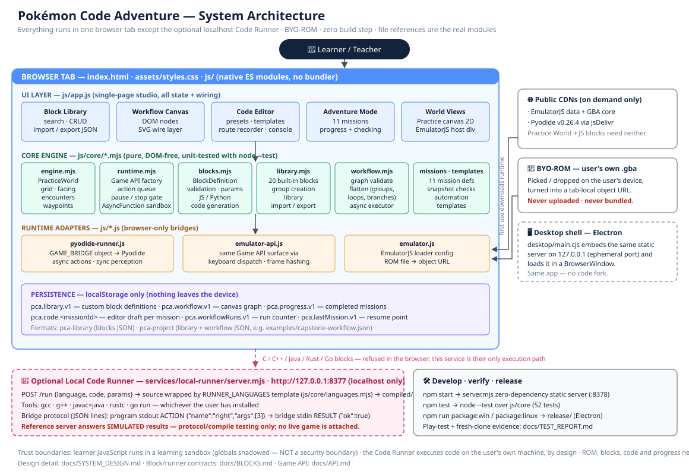
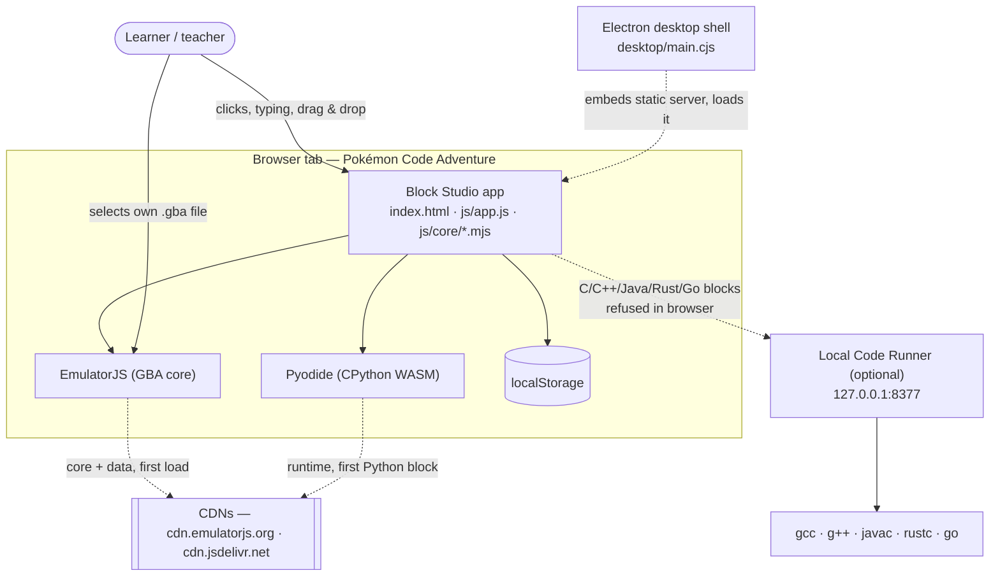

# System Design — Pokémon Code Adventure (Block Studio)

This document describes the system **as built**, with every claim mapped to a
real file. Where the implementation falls short of the ideal, the gap is
named and listed under [Known gaps & roadmap](#10-known-gaps--roadmap) —
nothing here documents fiction as fact.



*Diagram: [docs/architecture.svg](architecture.svg) — the same layers and
file references used throughout this document.*

---

## 1. Product overview

Pokémon Code Adventure teaches programming by letting a learner
**automate a Pokémon-style adventure**. The centrepiece is **Block
Studio**: learners build reusable, parameterised **code blocks** once,
instantiate them many times on a **workflow canvas**, wire them into
action sequences, and save selections as **group blocks** that are
themselves reusable and nestable. An 11-mission Adventure Mode climbs
from single steps to a capstone that must be completed with blocks and a
group.

Two game backends share one API:

- **Practice World** — a deterministic, built-in grid world. The whole
  learning path works here with no game ROM and no network.
- **GBA Emulator (experimental)** — the learner's own `.gba` file
  (BYO-ROM) running in EmulatorJS. The same API dispatches keyboard
  input; perception is limited to frame-change sensing.

### 1.1 Goals

| # | Goal | How the design serves it |
|---|------|------|
| G1 | Reusable blocks, not one-off scripts | Block definition model with typed parameters; instances carry their own values (§4.1, §5) |
| G2 | Blocks compose into groups, groups nest | Group blocks store a sub-workflow; execution and flattening recurse with a depth cap (§5.3) |
| G3 | Many languages, honestly labelled | Visual/JS/Python run in-browser; C/C++/Java/Rust/Go run only via a localhost runner (§6) |
| G4 | Zero-install learning path | Static web app, no build step, no dependencies; Practice World fully offline |
| G5 | No ROM distribution, ever | BYO-ROM via tab-local object URL; `.gitignore` blocks ROM/save files (§7.2) |
| G6 | Verifiable core logic | All game/block/workflow logic lives in pure, DOM-free modules with a `node --test` suite (§9) |

### 1.2 Non-goals

- **Not** a universal "one-click completes Pokémon" script. Emulator
  automation is a framework (templates, dialogue helper, battle-policy
  shapes, frame watching, save-state guidance); per-ROM tuning is the
  real work (§7.3).
- **Not** a security sandbox for untrusted code (§8).
- **Not** a cloud service: there is no account system, no server-side
  storage, no telemetry. All user data lives in the browser (§4.5).
- **Not** a general-purpose IDE or a Scratch clone: the block model is
  deliberately a thin, inspectable JSON graph so learners can read the
  format they are building.

---

## 2. System context



**Actors & external systems**

| Actor / system | Role | Trust |
|---|---|---|
| Learner | Writes code/blocks, runs workflows, supplies a ROM | Owns the machine and all data |
| Browser | Hosts the app, localStorage, canvas, WASM | Platform |
| EmulatorJS CDN | Serves emulator data/core on first ROM load | External; app degrades gracefully without it |
| jsDelivr CDN | Serves Pyodide on first Python block | External; same degradation |
| Local Code Runner | Compiles/runs C-family blocks on the learner's machine | **User's own code, user's own machine — by design** |
| Electron shell | Packages the identical web app for desktop | Same code, no fork |

---

## 3. Component architecture

The app is a **single-page static site** with three layers. There is no
bundler and no framework; modules are native ES modules, which is why the
same files run under `node --test`, the static server, and Electron
unchanged.

### 3.1 Layer map (real files)

| Layer | File | Responsibility |
|---|---|---|
| Shell | `index.html` | All panels and element IDs the app wires up; loads `js/app.js` as a module |
| Shell | `assets/styles.css` | Game-lab theme, canvas node/port styling |
| UI | `js/app.js` (772 lines) | **All** UI state and behaviour: library panel + block editor form, workflow canvas rendering (DOM nodes + SVG wires) and drag, node inspector, code editor + line numbers, console, missions panel, route recorder, run controls, emulator wiring, localStorage persistence |
| Core | `js/core/engine.mjs` | `PracticeWorld` — deterministic grid world (§4.4) |
| Core | `js/core/runtime.mjs` | Game API factory, sequential action queue, pause/stop gate, learner-code runner (AsyncFunction) |
| Core | `js/core/blocks.mjs` | Block definition model, validation, parameter resolution/coercion, `{{token}}` substitution, JS + Python code generation |
| Core | `js/core/library.mjs` | 20 built-in block definitions, library index, `pca-library` import/export, group creation from a canvas selection |
| Core | `js/core/workflow.mjs` | Workflow graph model, validation, static execution order, flattening (group/repeat/branch expansion), async executor |
| Core | `js/core/missions.mjs` | 11 mission definitions + snapshot/code/context checker |
| Core | `js/core/templates.mjs` | Automation templates (chapter route, dialogue, battle policy, grass patrol, frame watcher) + capstone reference solution |
| Core | `js/core/languages.mjs` | Language support matrix, ACTION/RESULT protocol constants, `RUNNER_LANGUAGES` adapter table + wrapper code generation |
| Adapter | `js/pyodide-runner.js` | On-demand Pyodide loading; builds the `GAME_BRIDGE` object Python code calls |
| Adapter | `js/emulator.js` | EmulatorJS configuration + loader injection; ROM file → object URL; ROM info |
| Adapter | `js/emulator-api.js` | Game API surface for emulator mode via keyboard-event dispatch + canvas frame hashing |
| Service | `server.mjs` | Zero-dependency static file server (Node `http`), path-traversal guarded; also importable by the Electron main process (`startStaticServer`) |
| Service | `services/local-runner/server.mjs` | Reference Code Runner: `POST /run`, `GET /health`; compiles/runs wrapped sources in a temp dir with a 20 s timeout |
| Desktop | `desktop/main.cjs` | Electron main process: starts the static server on 127.0.0.1 (ephemeral port) and loads it in a `BrowserWindow` |
| Examples | `examples/capstone-workflow.json` | Reference `pca-project`: a `Talk to NPC` group + full capstone workflow |
| Examples | `examples/capstone-solution.js` | The capstone solved as raw code (contrast with the block version) |

### 3.2 Dependency direction

```
index.html ──▶ js/app.js ──▶ js/core/*.mjs        (pure logic, no DOM)
                 │    └────▶ js/pyodide-runner.js ─┐
                 ├─────────▶ js/emulator.js        ├─ browser/CDN bridges
                 └─────────▶ js/emulator-api.js ───┘        │
                 js/core/languages.mjs ◀── services/local-runner/server.mjs
server.mjs ──▶ (serves all of the above; imported by desktop/main.cjs)
```

Rules that the code actually follows:

- `js/core/*` never touches the DOM, `window`, or `localStorage` —
  persistence and rendering are injected by `js/app.js`. This is what
  makes the core testable under plain Node.
- The core never imports the adapters. `executeWorkflow` receives a
  `pythonRunner` **hook** from the app instead of importing Pyodide.
- The local runner imports only `js/core/languages.mjs` (the adapter
  table); the browser app never imports the runner.

---

## 4. Data models

All models are plain JSON-serialisable objects. There is no database;
§4.5 covers persistence.

### 4.1 BlockDefinition (`js/core/blocks.mjs`)

```jsonc
{
  "id": "move-route",              // slug, /^[a-z0-9][a-z0-9-_]*$/
  "name": "Move Route",
  "description": "Walk east N tiles",
  "color": "#4f8ff7", "icon": "➡️",
  "language": "javascript",        // visual|javascript|python|group|c|cpp|java|rust|go
  "kind": "code",                  // start|action|control|code|group|end
  "params": [ { "name": "steps", "type": "number", "label": "Steps",
                "default": 1, "options": ["…"] /* select only */ } ],
  "body": "right(steps);",         // string (code) · { workflow } (group) · unused (visual)
  "action": null,                  // API action name for visual/action blocks
  "version": 1, "createdAt": "…", "updatedAt": "…", "builtin": false
}
```

Invariants enforced by `validateBlockDefinition`:
- valid slug id, non-empty name (≤ 60 chars), known language and kind,
  positive integer version;
- parameter names are unique valid identifiers; types are
  `number|string|boolean|select`; `select` parameters must carry a
  non-empty `options` list; defaults match their declared type;
- `code` blocks (and control blocks without an action) need a non-empty
  string body; `group` blocks need `body.workflow` with ≥ 1 node;
  `action` blocks need an `action` name.

**Ports are derived from the definition**, not stored:
`outputsFor(def)` — start → `[next]`; end → `[]`; Repeat control →
`[loop, next]`; If Blocked control → `[then, else]`; everything else →
`[next]`. `inputsFor(def)` — start → `[]`, everything else → `[in]`.

**Parameter binding.** `resolveParams(def, values)` merges instance
values over defaults and coerces by declared type (`Number(...)` with a
finiteness check, boolean from `true|"true"`, string via `String(...)`),
validating `select` membership. Code bodies receive parameters two ways:
as a generated prelude (`const steps = 5;` in JS, `steps = 5` in Python)
and via `{{token}}` substitution (`substituteParams`, which throws on an
unknown token).

### 4.2 WorkflowGraph / Node / Edge (`js/core/workflow.mjs`)

```jsonc
{
  "id": "wf-…", "name": "My Workflow",
  "nodes": [ { "id": "n-…", "defId": "move-route",
               "params": { "steps": 5 },          // instance values
               "position": { "x": 230, "y": 150 } // canvas layout only
             } ],
  "edges": [ { "from": { "node": "n-…", "port": "next" },
               "to":   { "node": "n-…", "port": "in" } } ],
  "entry": "n-…",              // group sub-workflows only: first node
  "paramBindings": [ { "groupParam": "steps", "nodeId": "n-…", "param": "steps" } ]
}
```

- One outgoing edge per `(node, port)` — `connect()` replaces an
  existing wire from the same port. All edges land on port `"in"`.
- `validateWorkflow` checks: unique node ids, known `defId`s, resolvable
  node parameters, edge endpoints exist, edge ports exist on the source
  definition, and (for top-level workflows) a Start block exists.

### 4.3 Group expansion (`js/core/library.mjs` + `workflow.mjs`)

`createGroupDefinition({ name, workflow, nodeIds, entryNodeId, exposedParams })`
turns a canvas selection into a group `BlockDefinition`:

- only nodes in the selection and edges with **both** endpoints selected
  are kept (deep-cloned);
- the entry node is the selected node with no incoming selected edge
  (or an explicit `entryNodeId`);
- each exposed parameter becomes a group-level parameter (name, type,
  label, default, **and `options` for selects**) plus a `paramBindings`
  entry linking it to the member node's parameter.

At run time, group invocation passes the resolved group values as
`scopeValues` into a recursive `executeWorkflow` on the sub-workflow;
`nodeValues()` applies `paramBindings` and `{ "$param": "name" }`
references before `resolveParams`. At analysis time, `flattenWorkflow`
performs the same resolution statically — the flattener and the executor
agree, including inside Repeat/If sub-chains (regression-tested).
Recursion depth is capped at 8 in the flattener; the executor is bounded
by its 2000-block guard (§5.4).

### 4.4 PlayerState — Practice World snapshot (`js/core/engine.mjs`)

The world itself is a class instance (`PracticeWorld`); mission checks
and the UI consume its immutable-by-convention `snapshot()`:

```jsonc
{ "x": 4, "y": 10, "facing": "right", "steps": 7, "grassSteps": 0,
  "bumps": 1, "talkedToNpc": true, "signsRead": 0,
  "encounterActive": false, "encountersStarted": 0, "encountersResolved": 0,
  "battlesWon": 0, "battlesFled": 0, "menusOpened": 0, "runMode": false,
  "atGoal": true, "inGrass": false,
  "waypointsVisited": 2, "waypointsTotal": 3, "currentWaypoint": { "x": 16, "y": 3 } }
```

World rules that matter to the design: the map is a string grid
(`#` tree, `H` house, `~` water, `S` sign, `N` NPC, `,` tall grass,
`.` open); a direction step **always turns the player first**, even when
blocked (true to the GBA games); `back()` steps without turning; an
encounter starts on **every 4th grass step** (deterministic, so tests
and missions are reproducible) and locks movement until resolved;
waypoints are consumed in order.

### 4.5 Mission (`js/core/missions.mjs`)

```jsonc
{ "id": "block-builder", "chapter": "Chapter 3 · Block Studio",
  "title": "Build a Reusable Block", "objective": "…", "briefing": "…",
  "starter": "// code placed in the editor",
  "hints": ["…"],
  "scenario": { "start": {"x":1,"y":10}, "facing": "right",
                "goals": [{"x":14,"y":10}], "waypoints": [] },
  "check": "(snapshot, code, ctx) => boolean",   // function, not JSON
  "studio": true }                               // optional: Block Studio mission
```

`checkMission(mission, snapshot, code, context)` never throws (a broken
check reads as "not complete"). Studio missions receive a context built
by the app — `{ customBlocks, workflowRuns, groupsUsed, library }` — so
completion can require *process evidence* (a custom block exists, a
workflow ran, a group executed), not just arrival at a tile.

### 4.6 Persistence (implemented in `js/app.js`)

| localStorage key | Content |
|---|---|
| `pca.library.v1` | Custom `BlockDefinition[]` (built-ins are code, never stored) |
| `pca.workflow.v1` | Current canvas `WorkflowGraph` |
| `pca.progress.v1` | Completed mission ids |
| `pca.workflowRuns.v1` | Completed workflow run counter (mission evidence) |
| `pca.code.<missionId>` | Editor draft per mission, saved on every input |
| `pca.lastMission.v1` | Last selected mission, saved on selection |

Interchange formats: `pca-library` (export/import of custom blocks via
the library panel text box; invalid/duplicate entries are skipped with
reasons) and `pca-project` (`{ format, version, blocks, workflow }`,
loaded by the *Load Capstone Project* button from
`examples/capstone-workflow.json`, fetched relative to the app root).

---

## 5. Execution engine design

### 5.1 Graph traversal

Execution (`executeWorkflow` in `js/core/workflow.mjs`) starts at the
Start node (or the group's `entry`) and walks edges recursively via
`runChain(startId, stopAt)`:

- **Linear nodes** run, then control follows the `next` edge.
- **End** nodes (or a missing edge) terminate the current chain.
- **Repeat**: the `loop` chain runs `times` times (clamped 0–100 at run
  time; the loop chain ends when it has no onward edge or points back at
  the Repeat node), then control follows `next`.
- **If Blocked**: `api.isBlocked()` chooses the `then` or `else` chain,
  which runs to its end. To rejoin the main flow, the branch's last block
  is wired onward to the shared next block (a documented wiring
  convention, §3 of `docs/BLOCKS.md`); after a branch, the enclosing
  chain returns.
- **Groups** recurse into `executeWorkflow` on the sub-workflow with the
  group's resolved values as scope.

Before running, the app calls `validateWorkflow` and refuses to start
with errors listed in the console. `executionOrder()` provides the
static main-chain order used for analysis/tests.

### 5.2 Node dispatch (by definition)

| Definition shape | Executed as |
|---|---|
| `kind: "group"` | Recursive `executeWorkflow` over `body.workflow` |
| `language: "python"` | `generatePython` → injected `pythonRunner` hook (Pyodide) |
| `language: "javascript"` or `kind: "code"` | `generateJavaScript` → `runUserCode` (action-queued runtime) |
| `language ∈ {c, cpp, java, rust, go}` | **Throws** a descriptive error: needs the local Code Runner; never runs in the browser |
| Visual action blocks | Direct switch over `action`: movement, `interact`, `pressB`, `pressStart`, `wait`, `attack`, `runAway`, `battlePolicy` (attack iff an encounter is active), `log` |

UI hooks (`onNodeStart`/`onNodeEnd`) drive canvas highlighting and the
`groupsUsed` mission evidence counter; `onLog` streams engine messages
to the console.

### 5.3 Parameter binding during execution

Per node: start from the node's stored instance values → apply the
enclosing group's `paramBindings` from `scopeValues` → expand
`{ "$param": name }` references → `resolveParams` (defaults + coercion +
validation). A resolution failure aborts the run with the block name and
reason. The same pipeline is used by the static flattener (§4.3).

### 5.4 Pause, stop, and runaway protection

- A shared `control = { stopped, paused }` object (owned by `js/app.js`)
  is checked by a `gate()` before every node and inside pacing/wait
  loops in both the workflow executor and the game API. Pause/stop are
  **cooperative**: they take effect at the next action boundary.
- Executor guard: more than 2000 executed blocks aborts the run
  ("possible infinite loop").
- Runtime guardrails: step counts clamp to 500 per API call, `wait`
  clamps to 60 s, Repeat clamps to 100 iterations at run time (20 in
  static flattening), group flatten depth caps at 8.
- Python blocks run to completion inside Pyodide — pause/stop apply
  *between* blocks, not inside one (§10).

### 5.5 The JavaScript runtime (`js/core/runtime.mjs`)

`createGameAPI(world, hooks)` builds the API object around any world
with the engine's surface. Every action is **chained onto a per-API
promise queue**: learner code works whether or not calls are awaited
(`right(3); up(2);` runs in order, like the printed examples in coding
books), errors surface through `drainAPI()` at the end of the run rather
than as unhandled rejections, and perception reads
(`position()`, `isBlocked()`, …) are synchronous — the documented rule
is "await movement before reading perception".

`runUserCode(code, api)` compiles the code with the `AsyncFunction`
constructor whose parameters are exactly the API names; common browser
globals (`window`, `document`, `fetch`, `localStorage`, `Function`, …)
are shadowed with `undefined`. Movement pacing comes from the UI speed
selector; run mode (B held) halves the per-step delay.

---

## 6. Language runtime design

### 6.1 Support matrix (single source of truth: `LANGUAGE_SUPPORT` in `js/core/languages.mjs`)

| Language | Runs where | Mechanism |
|---|---|---|
| Visual | Browser | Built-in/custom blocks wrapping one API action |
| JavaScript | Browser | §5.5 runtime |
| Python | Browser | Pyodide (WASM CPython), §6.2 |
| Group | Browser | §4.3 expansion/recursion |
| C, C++, Java, Rust, Go | Learner's machine | Local Code Runner, §6.3 |

### 6.2 Python via Pyodide + the GAME_BRIDGE contract

- Pyodide v0.26.4 is loaded **on demand** from jsDelivr the first time a
  Python block runs (`js/pyodide-runner.js`); the load promise is
  memoised and reset on failure. If the CDN is unreachable the block
  fails with a clear error and the rest of the app is unaffected.
- `generatePython(def, values)` emits: a bridge prelude
  (`from js import GAME_BRIDGE` + one Python function per API call), a
  parameter prelude with Python literals (`True`/`False`/`None`), then
  the block body with `{{token}}` substitution applied.
- **Bridge contract**: async game functions (`right`, `attack`, `wait`,
  `advanceDialogue`, …) return JS promises, so learner code uses
  top-level `await` (supported by `runPythonAsync`). Perception is
  exposed as synchronous `*Sync` bridge methods (`positionSync`,
  `isBlockedSync`, `encounterActiveSync`, `atGoalSync`, `inGrassSync`,
  `facingSync`) backed by the app's current-mode perception provider —
  real world state in Practice mode, honest estimates in Emulator mode
  (`{x:-1,y:-1}`, `"?"`, `false`).

### 6.3 Local Code Runner — JSON-lines ACTION/RESULT protocol

For languages that cannot run in a browser, `services/local-runner/`
provides a reference service (Node, zero dependencies):

- **API**: `GET /health` → supported languages; `POST /run`
  `{ language, code, params }` → `{ ok, stage, exitCode, actions, simulated, stderr }`.
  Binds `127.0.0.1:8377` only. Source size capped at 100 k chars;
  compile + run each capped by a 20 s timeout; work happens in a fresh
  temp directory that is deleted afterwards.
- **Adapter format** (`RUNNER_LANGUAGES` in `js/core/languages.mjs`):
  each language declares `ext`, `file`, `compile` argv (or `null`),
  `run` argv, and a `wrapper` source template containing
  `{{USER_CODE}}` and a `game_action(name, argsJson)` helper.
  `generateRunnerSource(language, body, params)` stamps a params header
  comment and splices the body into the wrapper. Adding a language =
  one table entry + one `LANGUAGE_SUPPORT` row + a test.
- **Protocol** (constants in `ACTION_PROTOCOL`): the running program
  prints `ACTION {"name":"right","args":[3]}` on stdout and reads one
  `RESULT {"ok":true}` line per action on stdin; perception actions may
  return `{"ok":true,"value":...}`; completion is signalled with a
  `DONE {"ok":true}` line.
- **Honesty boundary**: the reference server answers every ACTION with a
  **simulated** `RESULT {"ok":true,"simulated":true}` and reports the
  parsed actions. It proves compilation + protocol, **not** live game
  movement. Pairing the action queue with a live game (the app polls
  pending actions, executes them, posts results) is the documented
  integration step in `services/local-runner/README.md` — it is *not*
  implemented, and the UI executor refuses these languages in the
  browser rather than pretending (§10).

---

## 7. Game backends

### 7.1 Practice World engine (`js/core/engine.mjs`)

Covered in §4.4. Design choices worth noting: the map is data (a string
grid), NPC/sign positions are *derived* from the map at construction,
encounters are deterministic (every 4th grass step) so missions and
tests are reproducible, and `snapshot()` is the single read model for
mission checks, the stats pill, and test assertions.

### 7.2 Emulator integration (`js/emulator.js`, `js/emulator-api.js`)

- **BYO-ROM flow**: file picker or drag-and-drop → `.gba` extension
  check → `URL.createObjectURL(file)` → EmulatorJS globals
  (`EJS_player = "#emuGame"`, `EJS_core = "gba"`, `EJS_gameUrl`,
  `EJS_pathtodata = https://cdn.emulatorjs.org/stable/data/`) → loader
  script injected once. A second ROM requires a page reload (stated in
  the UI). The file is never read by app code beyond name/size, never
  uploaded, and `.gitignore` permanently excludes `*.gba/*.gb/*.gbc/
  *.sav/*.srm/*.state` from the repo.
- **Control**: the emulator API implements the same surface as the
  Practice API by dispatching `KeyboardEvent`s (arrows = D-pad,
  Z = A, X = B, Enter = Start, Shift = Select) to the canvas and
  document, with fixed tap/hold timings and the same pause/stop gate.
- **Perception**: canvas frame sampling produces `frameHash()` /
  `frameChanged()` — the honest primitives for "wait until the
  animation ends". Everything else is declared unknown: `position()` →
  `{x:-1, y:-1}`, `facing()` → last direction *sent*, `isBlocked()` /
  `atGoal()` / `inGrass()` / `encounterActive()` → `false`.
- **Battles are menus**: `attack()` sends A, A and `runAway()` sends a
  generic classic-layout cursor path (Down, Right, A); both log loud
  warnings that menu state varies by ROM. `turnLeft/turnRight` send no
  key (turning in place is game-dependent) and log why.

### 7.3 Practice World vs emulator — one API, two truths

| Capability | Practice World | Emulator |
|---|---|---|
| Movement/buttons | Exact engine semantics | Keyboard dispatch, timing-based |
| Position/facing | Exact | Unknown / last-sent guess |
| Blocked sensing | Exact (`isFacingBlocked`) | None (`false`) |
| Encounters | Deterministic, modelled | Real game state, invisible to the API |
| Mission checks | Snapshot-based, reliable | Not used (missions are Practice-only) |
| Purpose | Learn + verify | Transfer skills to a real game, experimentally |

---

## 8. Security & trust boundaries

| Boundary | Reality (as built) |
|---|---|
| Learner JavaScript | Runs via `AsyncFunction` in the page with API names as parameters and common globals shadowed. **This is a learning sandbox, not a security boundary** — object-graph escapes exist (e.g. via `({}).constructor`). The UI/docs say: never paste untrusted code. Acceptable because the code is the learner's own, in their own browser, with no server and no other users' data at risk. |
| Learner Python | Runs in Pyodide inside the same page; `GAME_BRIDGE` is the only intended capability. Same trust story as JS. |
| Imported libraries/projects | JSON is parsed and every definition is validated; invalid/duplicate entries are skipped with reasons. Imported *code bodies* are still code — same "only import from people you trust" rule, stated in `docs/BLOCKS.md`. |
| Local Code Runner | Executes arbitrary code with the user's privileges **by design** (it is a compiler runner). Mitigations: binds 127.0.0.1 only, 20 s timeouts, temp-dir isolation, 100 k source cap. Docs warn never to expose it on a network. |
| ROM & user data | ROM bytes never leave the tab; blocks/code/progress live in localStorage on the device. No analytics, no network calls except the two CDN runtime loads. |
| Static server | `server.mjs` normalises paths and refuses anything escaping the project root (403); read-only; binds 127.0.0.1. |
| Electron shell | Loads only its own embedded 127.0.0.1 server; `nodeIntegration` off, `contextIsolation` on; window opens no remote content directly (the page itself may contact the two CDNs, as in a browser). |

---

## 9. Error handling

- **Validation before execution**: block definitions and workflows are
  validated up front; errors are listed in the console and the run does
  not start.
- **Run-time aborts**: unknown blocks, unresolvable parameters,
  Python-without-Pyodide, and local-runner languages in the browser all
  throw descriptive, block-named errors; the executor's `finally`
  semantics remove canvas highlighting and reset the run controls.
- **Learner-code errors**: syntax errors and exceptions from
  `runUserCode` are caught and reported (`{ ok: false, error }`); queued
  action errors surface once via `drainAPI()` instead of as unhandled
  promise rejections. A user stop is a distinct `StopError` path
  ("⏹ Script stopped."), not an error message.
- **CDN failures**: EmulatorJS loader `onerror` and the 9 s
  canvas watchdog post plain-language status ("offline? Practice World
  still works"); a failed Pyodide load resets the memoised promise so a
  later run can retry, and the Python status pill reflects
  loading/ready.
- **Persistence failures**: localStorage reads/writes are wrapped —
  corrupt JSON falls back to defaults, quota/blocked storage is ignored
  rather than crashing the app.
- **Mission checks** never throw (§4.5).
- **Runner failures** are staged: `stage: "compile"` returns the
  compiler's stderr (truncated); spawn errors and timeouts return a
  non-zero exit path with the captured output.

---

## 10. UI layout

Three-column studio (`index.html` + `assets/styles.css`), collapsing to
two then one column at 1280 px / 820 px breakpoints:

- **Left column** — Block Library (search, built-ins, custom blocks,
  export/import, capstone loader), Block Editor form (name, language,
  colour, icon, visual-action select, parameter rows, body), Adventure
  Mode (mission list + detail with hints).
- **Centre column** — Practice World canvas (576×384, emoji-tile
  rendering with goal 🚩 / waypoint ⭐ overlays and an encounter banner)
  and the Emulator panel (ROM drop zone, `#emuGame` host, fullscreen).
- **Right column** — Workflow Canvas (absolutely-positioned DOM nodes,
  148 px port geometry, SVG bezier wires, port-coloured by type),
  node inspector for parameter editing, Code Editor (line numbers,
  presets/templates, run/pause/stop, speed selector, mission check,
  route recorder), Console, and the API quick-reference grid.
- **Top bar** — brand + status pills (Python runtime, emulator/ROM,
  mission progress). **Footer** — legal/BYO-ROM notice.

Execution feedback: the running node is highlighted
(`.wf-node.running`), the world re-renders on every API `step` event,
and the stats pill shows position/facing/steps live.

---

## 11. Testing strategy

| Level | Tooling | Coverage (52 tests) |
|---|---|---|
| Unit — engine | `tests/engine.test.mjs` (8) | Map integrity, movement/turning semantics, blocked-turn rule, interact targets, deterministic encounters + movement lock, flee, ordered waypoints |
| Unit — runtime | `tests/runtime.test.mjs` (7) | Awaited + un-awaited action ordering, perception reads, repeat/loops, stop flag, global shadowing, syntax-error reporting, encounter flow |
| Unit — blocks/library | `tests/blocks.test.mjs` (12) | Validation rules, param coercion, token substitution, JS/Python codegen (incl. bridge parity), slugify, library import/export round-trip + skip reasons, group creation (internal edges, entry pick, **select-option preservation**) |
| Unit — workflow | `tests/workflow.test.mjs` (12) | Validation, static order, linear execution, **parameterised reuse** (same def, different values), Repeat chains, If-Blocked branch choice, group execution + parameter forwarding, **nested groups**, flattening (repeats, branches, **bindings inside loop chains**) |
| Unit — missions | `tests/missions.test.mjs` (9) | Progression shape, Mission 1 pass/fail sensitivity, function-definition requirement, battle-policy starter, capstone by raw code, capstone by reference workflow JSON, studio-evidence requirements |
| Unit — languages | `tests/languages.test.mjs` (4) | Honest support matrix, runner adapter completeness, source generation + protocol constants |
| Integration — runner | Manual/live smoke (`docs/TEST_REPORT.md`) | `POST /run` with a C block compiled by gcc; actions parsed from stdout |
| Integration — browser | Headless Chrome (puppeteer-core) play-test | Real UI scenarios: load, Mission 1, block creation + reuse, grouping, capstone run, import — see `docs/TEST_REPORT.md` |
| Release gate | Fresh-clone check | Clone → `npm test` → server smoke → ROM scan of repo + ZIPs → Windows ZIP contains the `.exe` |

Core-module tests run under plain `node --test` with zero dependencies —
possible only because of the §3.2 dependency rules.

---

## 12. Packaging & release process

1. **Web (primary)**: the repo *is* the app. `npm start` serves it via
   `server.mjs` (127.0.0.1:8378); any static host works too. Zero
   dependencies means there is nothing to build.
2. **Desktop**: `desktop/main.cjs` (Electron main) imports
   `startStaticServer` from `server.mjs`, listens on an ephemeral
   127.0.0.1 port (override with `PCA_PORT`), and loads that URL.
   `@electron/packager` (devDependency) produces:
   - `npm run package:win` → `release/PokemonCodeAdventure-win32-x64/`
     (app folder containing `PokemonCodeAdventure.exe` — a packaged app
     folder, **not** a single-file portable exe);
   - `npm run package:linux` → `release/PokemonCodeAdventure-linux-x64/`
     for local smoke-testing of the shell.
   The distributable `Pokemon_Code_Adventure_Windows.zip` is the zipped
   Windows folder. `node_modules/` and `release/` are git-ignored.
   *Why an embedded server instead of `file://`*: the app uses ES
   modules, `fetch()` of the example project, and localStorage — all of
   which behave correctly and identically over `http://127.0.0.1`, and
   not reliably under `file://` (module CORS, fetch of local files).
3. **Versioning/commits**: small Conventional Commits; the test suite
   must be green at every commit; `docs/TEST_REPORT.md` is refreshed for
   release verification.

---

## 13. Known gaps & roadmap

Honest limitations of the current build, in rough priority order:

| # | Gap | Status / plan |
|---|---|---|
| R1 | Local-runner languages are not wired to a live game: the reference runner answers simulated RESULTs only | Roadmap — implement the polling bridge (`GET /pending-actions` / `POST /action-result`) sketched in `services/local-runner/README.md`; until then the browser executor refuses these languages instead of faking it |
| R2 | Python blocks are not pausable/stoppable mid-block (Pyodide runs to completion); pause/stop apply between blocks | Accepted limitation; documented in §5.4. A worker-based Pyodide host could make it interruptible |
| R3 | Emulator perception is frame-hash only — no position, no wall sensing, no text reading; battles are generic menu paths | Roadmap — per-ROM memory profiles are explicitly out of scope for the learning product; frame watching + save-state workflow is the supported technique |
| R4 | No project *export* from the UI (library export exists; the current workflow is only auto-saved locally; project files can be loaded but not saved out) | Roadmap — add "Export project" beside Load Capstone Project |
| R5 | Editor is a plain textarea (no syntax highlighting/autocomplete) | Accepted for zero-dependency scope; CodeMirror via CDN is the obvious upgrade |
| R6 | A second ROM cannot be loaded without a page reload (EmulatorJS single-instance behaviour) | Upstream constraint; the UI states it and offers a reload button |
| R7 | No automated browser E2E in CI — play-tests are run manually per release and recorded in `docs/TEST_REPORT.md` | Roadmap — promote the puppeteer-core script into `tests/e2e/` behind an opt-in script |

---

*Companion documents: [docs/API.md](API.md) (game API reference),
[docs/BLOCKS.md](BLOCKS.md) (Block Studio + runner contracts),
[docs/TEACHER_GUIDE.md](TEACHER_GUIDE.md) (classroom notes),
[docs/TEST_REPORT.md](TEST_REPORT.md) (verification evidence).*
